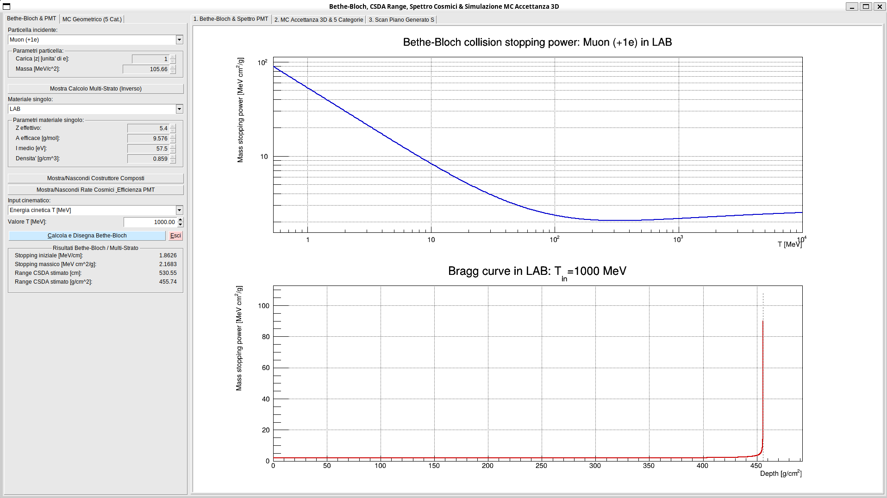
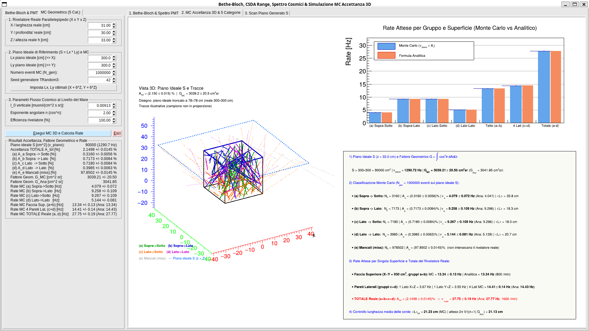
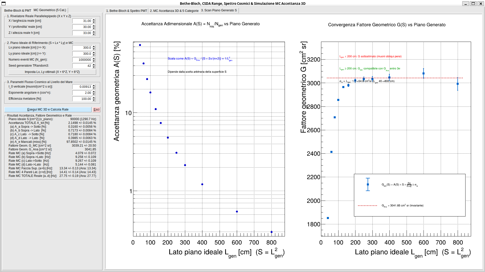
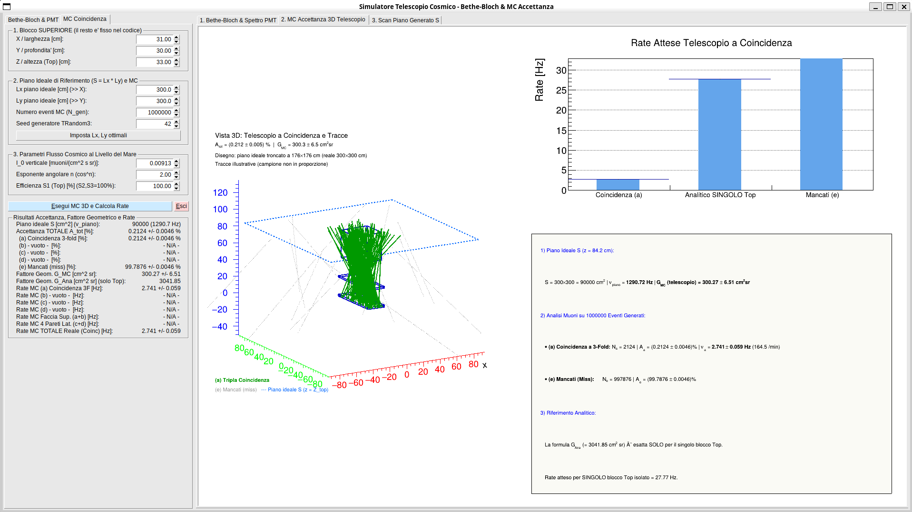

# Cosmic Muon & Detector Response Simulator (C++ / CERN ROOT GUI)

An interactive graphical application built in **C++** and **CERN ROOT** (`TGMainFrame`) for simulating charged-particle energy loss, sea-level cosmic-ray muon fluxes, PMT threshold efficiencies and 3D geometric acceptance in scintillation detectors and multi-layer cosmic telescopes.

<table>
  <tr>
    <td></td>
    <td></td>
  </tr>
  <tr>
    <td></td>
    <td></td>
  </tr>
</table>

## Key features

### 1. Relativistic Bethe-Bloch & CSDA range calculator

- **Single-medium and inverse multi-layer modes.** Computes the linear stopping power $`-dE/dx`$, the mass stopping power $`-dE/(\rho\,dx)`$, Bragg curves and CSDA ranges, integrated over 12,000 logarithmic energy steps. The inverse multi-layer solver (up to 10 layers in series, $`S_1 \dots S_N`$) finds the minimum incident kinetic energy and momentum a particle needs to cross the whole stack and stop at the bottom of $`S_N`$.
- **Physics corrections.** Maximum kinematic energy transfer $`T_{\max}`$, Sternheimer–Peierls density-effect parameterization, and Barkas–Berger shell corrections ($`\eta = \beta\gamma \ge 0.1`$).
- **Interactive compound & mixture builder.** Builds arbitrary molecules or mixtures (e.g. LAB scintillator, $`\mathrm{H_2O}`$, PMMA) from the elements in `materials.txt`, evaluating molar mass, electron density, $`\langle Z/A \rangle`$ and the Bragg-rule mean excitation energy $`I_{\text{Bragg}}`$.

### 2. Cosmic muon spectrum (Rastin 1984a) & PMT threshold efficiency

- Samples sea-level cosmic muons from the differential momentum spectrum of **Rastin (1984a)**, with angular distribution $`I(\theta) = I_0 \cos^n\theta`$.
- Propagates the muons through the passive overburden layers $`S_1 \dots S_{N-1}`$ into the active detector volume $`S_N`$ ($`L_x \times L_y \times L_z`$), separating **stopping muons** (candidates for $`\mu \to e \nu \bar{\nu}`$ decay measurements) from **through-going muons**.
- Applies a configurable photomultiplier (PMT) energy threshold ($`\Delta E \gt E_{\text{thr}}`$) to compute incident vs. detected rates and the overall detection efficiency $`\varepsilon_{\text{PMT}}`$.

### 3. 3D geometric acceptance Monte Carlo & plane-convergence scan

- **`lab.cpp` — single parallelepiped detector.** Generates $`N_{\text{gen}}`$ straight tracks across an ideal reference plane $`S = L_x \times L_y`$ at $`z = Z`$ and classifies them into 5 topological categories: *Top→Bottom*, *Top→Side*, *Side→Bottom*, *Side→Side* and *Miss*. MC rates, the geometric factor $`G_{\text{MC}}`$ and the mean chord length $`\langle L \rangle`$ are benchmarked against exact analytical formulas and generalized Cauchy–Crofton predictions.
- **`lab2.cpp` — 3-fold coincidence muon telescope.** Models a 3-layer scintillator telescope (top active block plus two intermediate/bottom trigger paddles separated by air gaps) to evaluate 3-fold coincidence rates and trigger efficiency.
- **Generation-plane convergence scan.** Sweeps 12 increasing generator-plane sizes $`S = L_{\text{gen}}^2`$ to verify the asymptotic convergence $`G_{\text{MC}}(S) \to G_{\text{Ana}}`$.

## Validation

The generation-plane scan (feature 3) checks that the Monte Carlo geometric factor converges to the analytical value as the generator plane grows.

> **TODO:** add one reference case with the numbers, e.g. a table or plot of $`G_{\text{MC}}(S)`$ vs. $`G_{\text{Ana}}`$ for a specific detector geometry (`mc_results.txt` already contains the convergence scan table).

## Repository structure

| File | Description |
|---|---|
| `lab.cpp` | Main GUI application: single-volume 3D geometric acceptance (5 topological classes), Bethe-Bloch/CSDA solver, compound builder, Rastin/PMT spectrum simulator. |
| `lab2.cpp` | Specialized GUI version for a 3-fold coincidence cosmic-muon telescope geometry. |
| `materials.txt` | Tab-separated database of elements, compounds and scintillators (e.g. LAB, polystyrene, liquid argon, iron, lead) with $`Z/A`$, mean excitation potential $`I`$, density $`\rho`$ and $`Z_{\text{eff}}`$. |
| `particles.txt` | Tab-separated database of incident charged particles (muons, pions, kaons, protons, alphas, heavy ions). |
| `preview1.png` … `preview4.png` | GUI screenshots. |

## Requirements

- **CERN ROOT 6.x**, built with GUI and 3D graphics support (`libGui`, `libGpad`, `libGraf3d`).

> **TODO:** state the exact ROOT version(s) you tested with, e.g. "Tested with ROOT 6.xx/xx on Linux/macOS".

## Usage

Make sure `materials.txt` and `particles.txt` are in the working directory, then launch a simulator through the ROOT interpreter:

```bash
# Single-detector 3D acceptance, Bethe-Bloch and Rastin/PMT simulator
root -l lab.cpp

# 3-fold coincidence telescope simulator
root -l lab2.cpp
```

## Generated outputs

| File | Content |
|---|---|
| `bethe_mc_results.root` | All generated `TGraph`, `TGraphErrors`, `TH1D` and `TCanvas` objects, organized in the subdirectories `BetheBloch`, `Spettro_Rastin_PMT` and `MonteCarlo_3D`. |
| `mc_results.txt` | Text report: topological event counts, acceptances, expected rates and convergence-scan tables (`lab.cpp`). |
| `mc_results_telescopio.txt` | Same kind of report for the telescope geometry (`lab2.cpp`). |

## References

- M. Rastin (1984a), sea-level cosmic-muon momentum spectrum.
- R. M. Sternheimer and R. F. Peierls, density-effect parameterization.
- Barkas–Berger shell corrections for the stopping power.
- Cauchy–Crofton formula for the mean chord length of convex bodies.

> **TODO:** replace each entry with the full reference (authors, journal, year, DOI) of the paper or book you used.

## Author

Alessio Proietti — M.Sc. student in Experimental Particle Physics, Università degli Studi Roma Tre.

## License

Released under the MIT License, see [LICENSE](LICENSE).
